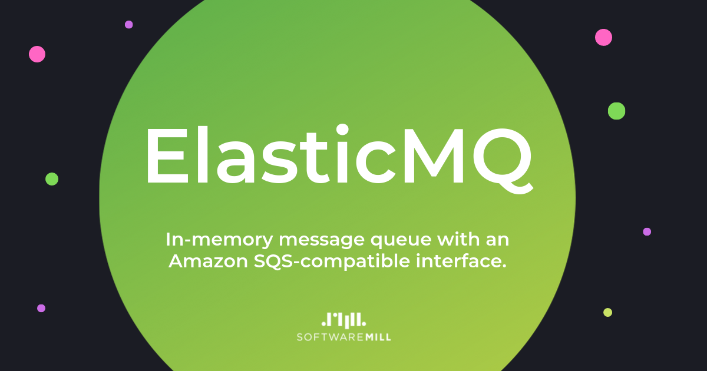

[](https://softwaremill.community/c/elasticmq)
[](https://github.com/softwaremill/elasticmq/actions?query=workflow%3A%22ElasticMQ+tests%22)
[](https://maven-badges.herokuapp.com/maven-central/org.elasticmq/elasticmq-rest-sqs_3/)

# tl;dr

* in-memory message queue system
* runs stand-alone, via [Docker](https://hub.docker.com/r/softwaremill/elasticmq-native/) or embedded
* [Amazon SQS](http://aws.amazon.com/sqs/)-compatible interface
* fully asynchronous implementation, no blocking calls
* optional UI, queue persistence
* created and maintained by:

<p align="center">
  <a href="https://softwaremill.com"></a>
</p>

# Summary

ElasticMQ is a message queue system, offering an actor-based Scala and an [SQS](http://aws.amazon.com/sqs/)-compatible
REST (query) interface.

ElasticMQ follows the semantics of SQS. Messages are received by polling the queue.
When a message is received, it is blocked for a specified amount of time (the visibility timeout).
If the message isn't deleted during that time, it will be again available for delivery.
Moreover, queues and messages can be configured to always deliver messages with a delay.

The focus in SQS (and ElasticMQ) is to make sure that the messages are delivered.
It may happen, however, that a message is delivered twice (if, for example, a client dies after receiving a message and
processing it, but before deleting). That's why clients of ElasticMQ (and Amazon SQS) should be idempotent.

As ElasticMQ implements a subset of the [SQS](http://aws.amazon.com/sqs/) query (REST) interface, it is a great SQS
alternative both for testing purposes (ElasticMQ is easily embeddable) and for creating systems which work both within
and outside of the Amazon infrastructure.

# Community

* [Issues](https://github.com/adamw/elasticmq/issues)
* [Discussions & help](https://softwaremill.community/c/elasticmq/7)

# Running locally

The easiest way to run ElasticMQ locally is with Docker Compose. Clone the repository and run:

```bash
docker compose up
```

This starts two services as defined in [`docker-compose.yaml`](docker-compose.yaml):

| Service | Port | Description |
|---------|------|-------------|
| `elasticmq` | `9324` | SQS-compatible REST API (`softwaremill/elasticmq-native`) |
| `elasticmq-ui` | `3000` | Web UI for monitoring and managing queues (`softwaremill/elasticmq-ui`) |

Once running, open **http://localhost:3000** in your browser to explore the UI — you can view queues, send messages, and monitor queue statistics in real time.

The compose file mounts `examples/elasticmq.conf` as the server configuration and persists queue data in a named Docker volume (`elasticmq-data`). To use a different configuration, edit `examples/elasticmq.conf` or point the volume mount at your own config file.

ElasticMQ uses [Typesafe Config](https://github.com/typesafehub/config) for configuration. Current ElasticMQ configuration values are:

```
include classpath("application.conf")

# What is the outside visible address of this ElasticMQ node
# Used to create the queue URL (may be different from bind address!)
# "*" means: use the protocol, host and port of the incoming request
node-address {
  protocol = http
  host = "*"
  port = 9324
  context-path = ""
}

rest-sqs {
  enabled = true
  bind-port = 9324
  bind-hostname = "0.0.0.0"
  # Possible values: relaxed, strict
  sqs-limits = strict
}

# Should the node-address be generated from the bind port/hostname
# Set this to true e.g. when assigning port automatically by using port 0.
generate-node-address = false

queues {
  # See next sections
}

queues-storage {
  # See next sections
}

# Region and account id which will be included in resource ids
aws {
  region = us-west-2
  account-id = 000000000000
}
```

# SQS limits

`rest-sqs.sqs-limits` (or `withSQSLimits` when embedding) selects how closely ElasticMQ follows SQS's limits:

- `strict` (the default) validates requests like SQS: queue name length, batch size, message attributes, allowed
  characters, wait time, and the ranges of queue attributes. A queue that doesn't set them gets the SQS defaults:
  messages are deleted 4 days after being sent (`MessageRetentionPeriod` = 345600 seconds, allowed 60 seconds to
  14 days), and a message, counting its body and attributes in bytes, can be at most 1 MiB (`MaximumMessageSize` =
  1048576, allowed 1024 to 1048576).
- `relaxed` turns these checks off. Messages never expire and have no size limit, unless the queue sets
  `MessageRetentionPeriod` or `MaximumMessageSize` (any positive value is accepted).

# How are queue URLs created

Some of the responses include a queue URL. By default (`node-address.host = "*"`), queue URLs use the protocol, host
and port of the incoming request, followed by `node-address.context-path`. A client that reaches ElasticMQ as
`http://elasticmq:9324` (e.g. a Docker Compose service name) gets queue URLs starting with `http://elasticmq:9324`.

To always return the same base URL, set `node-address.host` to a host name, together with the protocol, port and
context path.

Note that changing the `bind-port` and `bind-hostname` settings do not affect the queue URLs in any way unless
`generate-node-address` is `true`. In that case, the bind host/port are used to create the node address. This is
useful when the port should be automatically assigned (use port `0` in such case, the selected port will be
visible in the logs).

# Automatically creating queues on startup

Queues can be automatically created on startup by providing appropriate configuration:

The queues are specified in a custom configuration file. For example, create a `custom.conf` file with the following:

````
# the include should be done only once, at the beginning of the custom configuration file
include classpath("application.conf")

queues {
  queue1 {
    default-visibility-timeout = 10 seconds
    delay = 5 seconds
    receive-message-wait = 0 seconds
    dead-letters-queue {
      name = "queue1-dead-letters"
      max-receive-count = 3 // from 1 to 1000
    }
    fifo = false
    content-based-deduplication = false
    copy-to = "audit-queue-name"
    move-to = "redirect-queue-name"
    message-retention-period = 4 days
    maximum-message-size = 256K // bytes; 256K = 262144
    tags {
      tag1 = "tagged1"
      tag2 = "tagged2"
    }
  }
  queue1-dead-letters { }
  audit-queue-name { }
  redirect-queue-name { }
}
````

All attributes are optional (except `name` and `max-receive-count` when a `dead-letters-queue` is defined).
`message-retention-period` and `maximum-message-size` default to the values described in
[SQS limits](#sqs-limits).
`copy-to` and `move-to` attributes allow to achieve behavior that might be useful primarily for integration testing scenarios -
all messages could be either duplicated (using `copy-to` attribute) or redirected (using `move-to` attribute) to another queue.

Up to 1.x, these keys were camelCase (`defaultVisibilityTimeout`, `receiveMessageWait`, `deadLettersQueue`,
`maxReceiveCount`, `contentBasedDeduplication`, `copyTo`, `moveTo`), as was `aws.accountId`. The old keys are still
read, with a deprecation warning, and take precedence over the new ones if both are set.

### FIFO queue creation
To create FIFO queue set value of `fifo` config parameter to `true`.
You can add `.fifo` suffix to queue name yourself (a name containing `.` has to be surrounded with quotes), for example:
```
queues {
  "testQueue.fifo" {
    fifo = true
    content-based-deduplication = true
  }
}
```
If not then suffix will be added automatically during queue creation.

# Auto-creating queues on demand

ElasticMQ can automatically create a queue the first time any request targets it, instead of returning a
`NonExistentQueue` error. This is useful during development and testing — it removes the need to maintain a static list
of queue names in the configuration.

To enable, add the following to your configuration file:

```
auto-create-queues {
  enabled = true
}
```

Optionally, provide a `template` section to set default attributes for every auto-created queue:

```
auto-create-queues {
  enabled = true
  template {
    default-visibility-timeout = 30 seconds
    delay = 0 seconds
    receive-message-wait = 0 seconds
    dead-letters-queue {
      name = "my-dlq"
      max-receive-count = 3
    }
    fifo = false
    content-based-deduplication = false
    copy-to = "audit-queue-name"
    move-to = "redirect-queue-name"
    message-retention-period = 1 day
    maximum-message-size = 1M
    tags {
      env = "dev"
    }
  }
}
```

All `template` attributes are optional. If `template` is omitted, system defaults are used (30 s visibility timeout,
0 s delay, no DLQ, standard queue).

If the queue name ends with `.fifo`, the queue is always created as a FIFO queue regardless of the `fifo` template
setting.

# Persisting queues configuration

Queues configuration can be persisted in an external config file in the [HOCON](https://en.wikipedia.org/wiki/HOCON) 
format. Note that only the queue metadata (which queues are created, and with what attributes) will be stored, without 
any messages.

To enable the feature, create a custom configuration file with the following content:

````
# the include should be done only once, at the beginning of the custom configuration file
include classpath("application.conf")

queues-storage {
  enabled = true
  path = "/path/to/storage/queues.conf"
}
````

Any time a queue is created, deleted, or its metadata change, the given file will be updated. The file is written with
the same keys as queue definitions in the `queues` section. Files written by 1.x (with camelCase keys) are still read,
and are rewritten with the new keys on the next change.

On startup, any queues defined in the given file will be created. Note that the persisted queues configuration takes 
precedence over queues defined in the main configuration file (as described in the previous section) in the `queues`
section.

# Persisting queues and messages to SQL database

Queues and their messages can be persisted to SQL database in runtime.
All events like queue or message creation, deletion or update will be stored in H2 in-file database,
so that the entire ElasticMQ state can be restored after server restart.

To enable the feature, create a custom configuration file with the following content:

````
# the include should be done only once, at the beginning of the custom configuration file
include classpath("application.conf")

messages-storage {
  enabled = true
}
````

By default, the database file is stored in `/data/elasticmq.db`. In order to change it,
custom JDBC uri needs to be provided:

````
# the include should be done only once, at the beginning of the custom configuration file
include classpath("application.conf")

messages-storage {
  enabled = true
  uri = "jdbc:h2:/home/me/elasticmq"
}
````

On startup, any queues and their messages persisted in the database will be recreated.

ElasticMQ answers a request after its changes are committed to the database. With H2, it adds `WRITE_DELAY=0` to the
URI, so that each commit is written to the database file first: by default H2 writes commits to the file later, in the
background, and a killed process (`kill -9`, an OOM kill, `docker kill`) would lose messages whose send was already
acknowledged. This makes durable sends and receives slower. The file isn't forced to disk, so an operating system
crash or power loss can still lose the most recent changes. To use another write delay, set `WRITE_DELAY` in the URI. Messages older than their
queue's retention period (4 days by default with `strict` [SQS limits](#sqs-limits)) are deleted shortly after.
Note that the persisted queues take precedence over the queues defined
in the main configuration file (as described in the previous section) in the `queues` section.

# ElasticMQ dependencies in SBT

```scala
// Scala 2.13 and 3
val elasticmqSqs        = "org.elasticmq" %% "elasticmq-rest-sqs" % Version
```

If you don't want the SQS interface, but just use the actors directly, you can add a dependency only to the `core`
module:

```scala
val elasticmqCore       = "org.elasticmq" %% "elasticmq-core" % Version
```

If you want to use a snapshot version, you will need to add the [https://oss.sonatype.org/content/repositories/snapshots/](https://oss.sonatype.org/content/repositories/snapshots/) repository to your configuration.

# ElasticMQ dependencies in Maven

Dependencies:

```xml
<dependency>
    <groupId>org.elasticmq</groupId>
    <artifactId>elasticmq-rest-sqs_3</artifactId>
    <version>${version}</version>
</dependency>
```

If you want to use a snapshot version, you will need to add the [https://oss.sonatype.org/content/repositories/snapshots/](https://oss.sonatype.org/content/repositories/snapshots/) repository to your configuration.

# Logging

ElasticMQ uses [Slf4j](http://www.slf4j.org/) for logging. By default, no logger backend is included as a dependency,
however [Logback](http://logback.qos.ch/) is recommended.

# Starting an embedded ElasticMQ server with an SQS interface

Add ElasticMQ Rest SQS module to `build.sbt` dependencies

```scala
libraryDependencies += "org.elasticmq" %% "elasticmq-rest-sqs" % Version
```

Then build and start a server with `SQSRestServerBuilder`:

```scala
val server = SQSRestServerBuilder.start()
// ... use ...
server.stopAndWait()
```

If you need to bind to a different host/port, there are configuration methods on the builder:

```scala
val server = SQSRestServerBuilder.withPort(9321).withInterface("localhost").start()
// ... use ...
server.stopAndWait()
```

You can also set a dynamic port with a port value of `0` or by using the method `withDynamicPort`. To find out the
assigned port, wait for the server to start; `waitUntilStarted` returns the bound address:

```scala
val server = SQSRestServerBuilder.withDynamicPort().start()
val port = server.waitUntilStarted().localAddress.getPort
```

To be notified about changes in queues and messages, register a `QueueEventListener`. All its methods have empty
defaults, so override only the ones you need:

```scala
val server = SQSRestServerBuilder
  .withQueueEventListener(new QueueEventListener {
    override def messageAdded(queueName: String, message: MessageData): Unit =
      println(s"New message in $queueName: ${message.content.value}")
  })
  .start()
```

Callbacks run one at a time. The message callbacks run before the SQS response is sent, so keep them fast.

By default the server creates its own Pekko `ActorSystem` and terminates it on `stopAndWait()`. If your application
already runs one, pass it with `withActorSystem(actorSystem)`; the server then uses it but leaves its lifecycle to you.

Embedded ElasticMQ can be used from any JVM-based language (Java, Scala, etc.):

```java
SQSRestServer server = SQSRestServerBuilder.withDynamicPort().start();
int port = server.waitUntilStarted().localAddress().getPort();
// ... use ...
server.stopAndWait();
```

(Note that the embedded server created with `SQSRestServerBuilder` does not load any configuration files, so you cannot
automatically create queues on startup as described above. You can of course create queues programmatically. To run a
server driven by a configuration file, including queue persistence, use the `elasticmq-server` artifact:
`new ElasticMQServer(new ElasticMQServerConfig(ConfigFactory.load("elasticmq.conf"))).start()`.)

# Using the Amazon Java SDK to access an ElasticMQ Server

To use [Amazon Java SDK](http://aws.amazon.com/sdkforjava/) as an interface to an ElasticMQ server you just need
to change the endpoint:
                      
```java
String endpoint = "http://localhost:9324";
String region = "elasticmq";
String accessKey = "x";
String secretKey = "x";
AmazonSQS client = AmazonSQSClientBuilder.standard()
    .withCredentials(new AWSStaticCredentialsProvider(new BasicAWSCredentials(accessKey, secretKey)))
    .withEndpointConfiguration(new AwsClientBuilder.EndpointConfiguration(endpoint, region))
    .build();
```    

The endpoint value should be the same address as the `NodeAddress` provided as an argument to
`SQSRestServerBuilder` or in the configuration file.

The `rest-sqs-testing-amazon-java-sdk` module contains some more usage examples.

# Using the Amazon boto (Python) to access an ElasticMQ Server

To use [Amazon boto](http://docs.pythonboto.org/en/latest/) as an interface to an ElasticMQ server you set up the connection using:
        
```python
region = boto.sqs.regioninfo.RegionInfo(name='elasticmq',
                                        endpoint=sqs_endpoint)
conn = boto.connect_sqs(aws_access_key_id='x',
                        aws_secret_access_key='x',
                        is_secure=False,
                        port=sqs_port,
                        region=region)
```

where `sqs_endpoint` and `sqs_port` are the host and port.

The `boto3` interface is different:

```python
client = boto3.resource('sqs',
                        endpoint_url='http://localhost:9324',
                        region_name='elasticmq',
                        aws_secret_access_key='x',
                        aws_access_key_id='x',
                        use_ssl=False)
queue = client.get_queue_by_name(QueueName='queue1')
```

# Performance

Tests done on a 2012 MBP, 2.6GHz, 16GB RAM, no replication. Throughput is in messages per second (messages are
small).

Directly accessing the client:

```
Running test for [in-memory], iterations: 10, msgs in iteration: 100000, thread count: 1.
Overall in-memory throughput: 21326.054040

Running test for [in-memory], iterations: 10, msgs in iteration: 100000, thread count: 2.
Overall in-memory throughput: 26292.956117

Running test for [in-memory], iterations: 10, msgs in iteration: 100000, thread count: 10.
Overall in-memory throughput: 25591.155697
```

Through the SQS REST interface:

```
Running test for [rest-sqs + in-memory], iterations: 10, msgs in iteration: 1000, thread count: 20.
Overall rest-sqs + in-memory throughput: 2540.553587

Running test for [rest-sqs + in-memory], iterations: 10, msgs in iteration: 1000, thread count: 40.
Overall rest-sqs + in-memory throughput: 2600.002600
```

Note that both the client and the server were on the same machine.

Test class: `org.elasticmq.performance.LocalPerformanceTest`.

# Building, running, and packaging

To build and run with debug (this will listen for a remote debugger on port 5005):
```
~/workspace/elasticmq $ sbt -jvm-debug 5005
> project server
> run
```

To build a jar-with-dependencies:
```
~/workspace/elasticmq $ sbt
> project server
> assembly
```

## Building the Docker images

The Docker images are built from plain Dockerfiles, using jars produced by sbt (this is what CI does):

```
sbt "project server; assembly" "project nativeServer; package"
mkdir -p server/target native-server/target
cp target/out/jvm/scala-*/elasticmq-server/elasticmq-server-assembly-*.jar server/target/elasticmq-server.jar
cp target/out/jvm/scala-*/elasticmq-native-server/elasticmq-native-server_*.jar native-server/target/elasticmq-native-server.jar

docker build -f server/Dockerfile -t softwaremill/elasticmq:local .
docker build -f native-server/Dockerfile -t softwaremill/elasticmq-native:local .
```

The native image is compiled inside the `native-server/Dockerfile` build with GraalVM Community for JDK 25. The binary
is *mostly static* (`--static-nolibc`): everything except glibc is linked in, so it resolves hostnames through DNS (e.g.
`rest-sqs.bind-hostname` can be a Docker network alias). It runs on the distroless
[`gcr.io/distroless/base-nossl-debian13`](https://github.com/GoogleContainerTools/distroless) image, which contains
glibc and CA certificates, but no shell or package manager. To extend the image with extra tools, copy the binary
(`/opt/elasticmq/bin/elasticmq-native-server`) into a glibc-based image (e.g. `debian:trixie-slim`). The binary handles
`SIGTERM`/`SIGINT` itself; use `docker run --init` if you need an init process to reap zombie processes. Do not forget
to adjust the CPU and memory settings for the Docker process. It was checked with 6CPUs, 8GB of memory and 2GB of swap.

Multi-architecture images are published by CI: the `amd64` and `arm64` images are built on separate runners and then
combined into a single manifest with `docker buildx imagetools create`.

## Generating GraalVM config files

The GraalVM reachability metadata (`native-server/src/main/resources/META-INF/native-image/reachability-metadata.json`)
is generated with the native-image tracing agent of GraalVM for JDK 25 and is automatically used by the native-image
process. The easiest way to update it is to run the integration tests, which start the fat-jar with the agent in
`config-merge-dir` mode and write the result straight into that directory:

```
sbt "project server; assembly"
docker build -t elasticmq-int -f integration-tests/docker/Dockerfile .
cd integration-tests/python && uv run pytest
```

The agent can also be run manually, e.g. inside a GraalVM container:

```
docker run -it -v `pwd`:/opt/graalvm --entrypoint /bin/bash --rm ghcr.io/graalvm/jdk-community:25i5-25.0.5.0.3
java -agentlib:native-image-agent=config-merge-dir=native-server/src/main/resources/META-INF/native-image -Dconfig.file=test.conf -jar elasticmq-server-assembly.jar
```

The `ci-native-image-agent-config-verification` CI job runs the integration tests with the agent enabled and fails if
the committed config files are out of date.

# Tests and coverage

To run the tests:
```
~/workspace/elasticmq $ sbt test
```

To check the coverage reports:
```
~/workspace/elasticmq $ sbt
> coverage
> tests
> coverageReport
> coverageAggregate
```

Although it's mostly only the core project that is relevant for coverage testing, each project's report can be found
in their target directory:

 * target/out/jvm/scala-<version>/elasticmq-core/scoverage-report/index.html
 * target/out/jvm/scala-<version>/elasticmq-common-test/scoverage-report/index.html
 * target/out/jvm/scala-<version>/elasticmq-rest-sqs/scoverage-report/index.html
 * target/out/jvm/scala-<version>/elasticmq-server/scoverage-report/index.html

The aggregate report can be found at target/out/jvm/scala-<version>/elasticmq-root/scoverage-report/index.html

# UI

ElasticMQ ships with a web UI for monitoring and managing queues. The UI provides real-time queue statistics, message sending, and queue details.

**Via Docker Compose** (see [Running locally](#running-locally)): the UI starts automatically and is available at **http://localhost:3000**.

**Via npm** (for development):

```bash
cd ui
npm install
npm run dev
```

The dev server starts at **http://localhost:3000** and expects ElasticMQ running at `http://localhost:9324`. Configure the endpoint in `ui/.env.local` (copy from `ui/.env.local.example`) if needed.

**Pointing the UI at a real AWS account** is also supported — the UI uses the standard AWS SDK and works with any SQS-compatible endpoint. Set your credentials and region in `ui/.env.local` and leave `SQS_ENDPOINT` unset so the SDK defaults to the real AWS endpoint:

```bash
# ui/.env.local — real AWS example
AWS_REGION=us-east-1
AWS_ACCESS_KEY_ID=AKIA...
AWS_SECRET_ACCESS_KEY=...
NEXT_PUBLIC_AUTO_REFRESH_DISABLED=true
```

The credentials need at minimum `sqs:ListQueues` and `sqs:GetQueueAttributes` for read-only access, plus `sqs:SendMessage`, `sqs:ReceiveMessage`, `sqs:DeleteMessage`, `sqs:CreateQueue`, and `sqs:DeleteQueue` for full functionality.

**Feature flags** (set in `ui/.env.local`):

| Variable | Description |
|----------|-------------|
| `NEXT_PUBLIC_AUTO_REFRESH_DISABLED=true` | Disables the automatic 1-second state refresh. Recommended when pointing at real AWS to avoid unnecessary API calls and costs. The UI switches from a pulsing live indicator to a static "Manual" label; the Refresh button continues to work. |

# MBeans

ElasticMQ exposes `Queues` MBean. It contains three operations:
* `QueueNames` - returns array of names of queues
* `NumberOfMessagesForAllQueues` - returns tabular data that contains information about number of messages per queue
* `getNumberOfMessagesInQueue` - returns information about number of messages in specified queue

# Health check endpoint

When running the server in a container orchestration environment, it may be useful to have a health check endpoint.
ElasticMQ provides a simple health check endpoint that can be used for this purpose. The endpoint is available at `/health`.

# Technology

* Core: [Scala](http://scala-lang.org) and [Pekko](https://pekko.apache.org/).
* Rest server: [Pekko HTTP](https://pekko.apache.org/docs/pekko-http/current/), a high-performance,
  asynchronous, REST/HTTP toolkit.
* Testing the SQS interface: [Amazon Java SDK](http://aws.amazon.com/sdkforjava/);
  see the `rest-sqs-testing-amazon-java-sdk` module for the testsuite.

# Commercial Support

We offer commercial support for ElasticMQ and related technologies, as well as development services. [Contact us](https://softwaremill.com) to learn more about our offer!

# Copyright

Copyright (C) 2011-2021 SoftwareMill [https://softwaremill.com](https://softwaremill.com).
